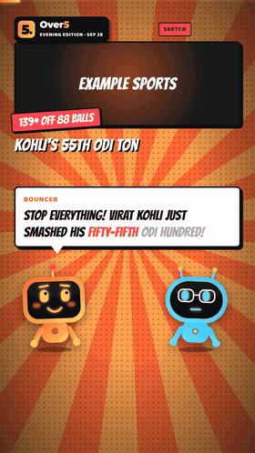
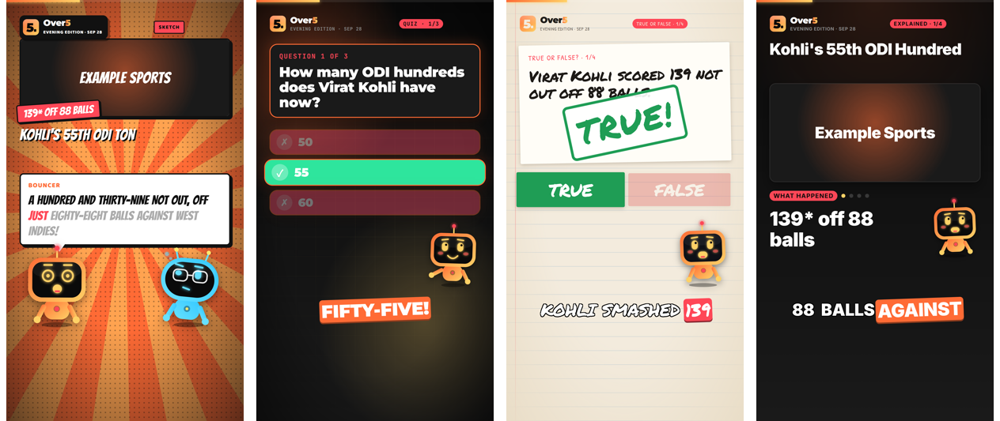
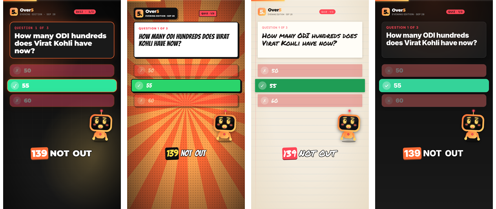

<div align="center">



# ShortForge

**Daily short videos for any niche: researched, scripted, voiced, animated and captioned automatically.**

Comedy sketches, quizzes, true-or-false games, explainers and countdowns for YouTube Shorts and Instagram Reels.
Free and open source; everything runs on your own computer.


[Install](#-install) · [Quick start](#-quick-start) · [Formats & themes](#-formats-and-themes) · [Commands](#-command-reference) · [Configuration](#%EF%B8%8F-configuration) · [FAQ](#-faq-and-troubleshooting)

</div>

---

## ✨ What it does

You describe a niche once (for example "cricket news for Indian fans, funny").
From then on, every day ShortForge:

1. **Finds the news**: reads RSS feeds, Reddit, Hacker News and daily.dev, and picks the stories that fit your audience.
2. **Writes the script** with a free open-source AI model, in the format of the day (sketch, quiz, explainer...).
3. **Fact-checks it** against the source articles and fixes wrong names, numbers and tenses.
4. **Voices it** with a natural AI voice that runs on your computer (English, Hindi, Spanish, French, Italian, Portuguese).
5. **Animates it**: a vertical 1080×1920 video with your brand, animated presenter characters that lip-sync and react, word-by-word captions, music and sound effects.
6. **Prepares the upload**: title, description, tags, hashtags, Instagram caption, pinned comment and a cover image.

Every channel gets its own name, logo, colours, characters, visual theme and mix of formats, so no two channels look alike.

## 🎬 Formats and themes

Each niche rotates through its own formats, never the same one twice in a row:

<p align="center"></p>

| Format | The video |
|---|---|
| `sketch` | Two original cartoon characters (a host and a co-host with different voices) banter about one story in speech bubbles. |
| `quiz` | Three questions from today's news, three options each, a 3-second timer, then the reveal. |
| `truefalse` | Four claims, some real and some with one detail changed, a moment to guess, then a TRUE / FALSE stamp and the real fact. |
| `explainer` | One big story in four beats: what happened, why it matters, the twist, what's next. |
| `countdown` | The day's top N stories, from #N down to #1. |

Four visual themes (the same quiz below), chosen per niche:

<p align="center"></p>

`neon` (futuristic) · `comic` (pop-art sunburst, thick outlines) · `paper` (notebook, marker fonts) · `minimal` (clean and flat)

## 📦 Install

One command on Linux, macOS or Windows (inside [WSL2](https://learn.microsoft.com/windows/wsl/install)):

```bash
curl -fsSL https://raw.githubusercontent.com/himanshu-kr-jha/shortforge/main/install.sh | bash
```

Or from a clone:

```bash
git clone https://github.com/himanshu-kr-jha/shortforge.git
cd shortforge
./install.sh
```

The installer walks you through everything:

1. Checks for git, curl, ffmpeg, Node.js 18+ and Python 3.10-3.12, and offers to install whatever is missing (it asks before using `sudo`).
   If your system only has a newer Python, it downloads a private Python 3.12 with [uv](https://github.com/astral-sh/uv), without touching your system Python.
2. Installs the voice engine, the video renderer and the voice model into the ShortForge folder (3-10 minutes the first time).
3. Helps you connect a free AI model: pick a provider, paste the key, and it tests the connection.
4. Adds the `shortforge` command to your PATH.
5. Runs a health check and shows you how to make your first video.

<details>
<summary><b>Installer options</b> (unattended installs, custom folder)</summary>

```bash
./install.sh --dir ~/apps/shortforge          # install somewhere else (default: ~/shortforge)
./install.sh --yes                            # no questions; installs missing requirements
./install.sh --provider groq --key gsk_...    # configure the AI model without prompts

# the same through curl:
curl -fsSL https://raw.githubusercontent.com/himanshu-kr-jha/shortforge/main/install.sh | bash -s -- --yes --provider groq --key gsk_...
```

</details>

<details>
<summary><b>Requirements</b></summary>

| | Minimum | Recommended |
|---|---|---|
| System | Linux, macOS, or Windows 10/11 with WSL2 | |
| CPU | 4 cores | 8+ cores (a 60 s video renders in 2-4 minutes) |
| Memory | 8 GB | 16 GB |
| Disk | 3 GB | 5 GB (videos are ~30 MB each) |
| GPU | not needed | |
| Internet | to fetch news and reach the AI model | |

</details>

<details>
<summary><b>Update or uninstall</b></summary>

```bash
shortforge update                       # latest version (git pull + dependency refresh)

# uninstall: stop schedules, then delete the folder and the command
shortforge unschedule <niche>           # for each scheduled niche
rm -rf ~/shortforge ~/.local/bin/shortforge
```

</details>

## 🚀 Quick start

**1. Create your channel** (about 2 minutes):

```bash
shortforge new
```

It asks for a channel name, what the niche is about, the audience, language, voice, style (news or comedy) and posting times.
The AI then designs the rest: brand colours, logo, the presenter characters and their personalities, editorial rules, hashtags and news sources.
Every suggested source is tested live and off-topic or broken feeds are dropped.
Your profile picture, logo and YouTube banner are saved in `niches/<niche>/brand/`.

Two example niches are included so you can try it right away: `tech-daily` (tech news) and `over5` (cricket comedy).

**2. Make a video** (4-8 minutes):

```bash
shortforge run over5
shortforge run over5 --format quiz      # or pick the format
```

You get a folder like `output/over5/2026-09-28-evening/` with:

| File | What it is |
|---|---|
| `short.mp4` | The video: 1080×1920, about 40-65 seconds, loudness-normalised for Shorts and Reels |
| `cover.jpg` | Cover image for the Reel / Shorts thumbnail |
| `UPLOAD.md` | Title, description, tags, pinned comment, Instagram caption with hashtags, and a fact-check list with source links |
| `script.json` | The script; edit it and run `shortforge reuse <niche> <folder>` to re-render |
| `sources.json` | The article text every line was written from |

**3. Put it on autopilot**:

```bash
shortforge schedule over5
```

Videos are made every day at the niche's times.
If your computer is asleep at that time, the video is made as soon as it wakes up; you get a desktop notification when it is ready.

Then, each day: watch `short.mp4`, skim the fact-check list in `UPLOAD.md`, and upload.

## 🧠 How it works

```mermaid
flowchart LR
    A[News sources<br/>RSS · Reddit · Hacker News · daily.dev] --> B[Pick stories<br/>for today's format]
    B --> C[Read the articles]
    C --> D[Write the script<br/>free open-source LLM]
    D --> E[Fact-check against sources<br/>reasoning mode]
    E --> F[Voice it<br/>Kokoro TTS, on your computer]
    F --> G[Fit the length<br/>shorten over-long lines]
    G --> H[Animate<br/>Remotion + themes + characters]
    H --> I[short.mp4 · cover.jpg · UPLOAD.md]
```



- **Scripts**: an open-source LLM through a free API (Groq, NVIDIA, Cerebras, OpenRouter, Gemini) or a local model with Ollama.
- **Voices**: [Kokoro](https://huggingface.co/hexgrad/Kokoro-82M), a small open-weight text-to-speech model that runs on the CPU and gives word timings for the captions.
- **Video**: [Remotion](https://www.remotion.dev) renders React components frame by frame with headless Chrome.
- **Characters**: original vector robots drawn in code; their mouths follow the loudness of the voice, and their expressions follow the mood the script assigns to each line.

## ⌨️ Command reference

| Make videos | |
|---|---|
| `shortforge new` | Create a niche (asks a few questions) |
| `shortforge list` | Your niches, themes, formats and schedules |
| `shortforge run <niche> [edition]` | Make a video now (`--format`, `--set key=value`, `--landscape`) |
| `shortforge reuse <niche> <folder>` | Re-voice and re-render after editing `script.json` |
| `shortforge schedule <niche>` | Make videos automatically every day |
| `shortforge unschedule <niche>` | Stop automatic videos |

| Configure | |
|---|---|
| `shortforge config <niche>` | Interactive menu for every setting (with voice previews) |
| `shortforge show <niche>` | All settings at a glance |
| `shortforge set <niche> <key> <value>` | Change one setting (validated) |
| `shortforge get <niche> <key>` | Read one setting |
| `shortforge keys` | Every setting with its allowed values |
| `shortforge sources <niche> [add\|remove\|test]` | Manage news sources |
| `shortforge voices [language]` | Available voices |
| `shortforge voice-test <niche> [host\|cohost]` | Hear a voice before using it |
| `shortforge llm [provider [model]]` | Show or switch the AI model |
| `shortforge brand <niche>` | Re-render the profile picture, logo and banner |

| Maintain | |
|---|---|
| `shortforge doctor [--llm]` | Check the installation and explain how to fix problems |
| `shortforge update` | Update to the latest version |
| `shortforge studio` | Open the animation editor with a live preview |
| `shortforge help` / `--version` | Help and version |

## ⚙️ Configuration

Everything about a niche lives in `niches/<niche>/niche.json`, but you never have to edit it by hand.

**Interactive menu:**

```text
$ shortforge config over5

== Over5 (over5) ==
  1. Channel      2. Content      3. Look        4. Characters   5. Voices
  6. Schedule     7. Editorial    8. Video       9. Sources
  p. Preview host voice   c. Preview co-host voice   s. Show all
  w. Save and quit        q. Quit without saving
> 3
-- Look --
   1. Visual theme                                         comic
   2. Use article images (no = generated title cards)      yes
Number to change (Enter = back): 1
  theme = comic   (one of: neon, comic, paper, minimal)
  New value (Enter = keep): paper
  -> paper   (not saved yet: choose 'w' to save)
```

**One-line changes** (every value is validated; the previous version is kept as `niche.json.bak`):

```bash
shortforge set over5 theme paper
shortforge set over5 formats quiz,sketch,truefalse
shortforge set over5 style comedy
shortforge set over5 voice.pitch 1.15             # 1.0 natural, higher = cartoon, lower = deeper
shortforge set over5 language hindi               # also switches both characters to Hindi voices
shortforge set over5 editions.morning.time 08:30  # schedules update automatically
shortforge set over5 mascot.name Bouncer

shortforge sources over5 add https://example.com/feed.xml "Example News"
shortforge sources over5 add r/Cricket            # a subreddit
shortforge sources over5 test                     # check every feed still works

shortforge run over5 --set theme=minimal --set voice.pitch=1.2   # try settings for one video only
```

<details>
<summary><b>All settings</b></summary>

| Key | Values | What it controls |
|---|---|---|
| `channel.name`, `channel.handle`, `channel.tagline` | text | Branding shown in every video |
| `channel.logo.glyph` | 1-2 characters | The letter or number in the logo tile |
| `channel.logo.plain`, `channel.logo.accent` | text | The wordmark, split into a plain part and a gradient part |
| `channel.colors.primary / accent / hot / bg` | `#RRGGBB` | Brand colours (the co-host automatically gets the complementary colour) |
| `style` | `news`, `comedy` | Straight news, or jokes and punchlines (facts stay exact) |
| `formats` | `sketch, quiz, truefalse, explainer, countdown` | Formats to rotate |
| `count` | 3-7 | Stories in a countdown |
| `language` | english, english (uk), hindi, spanish, french, italian, portuguese | Language of all text and voices |
| `labels.topic` | text | On-screen topic word ("TODAY IN CRICKET") |
| `theme` | `neon`, `comic`, `paper`, `minimal` | Visual theme |
| `useArticleImages` | yes / no | Use each article's own image, or generated title cards |
| `mascot.enabled` | yes / no | Animated presenter (needed for sketches) |
| `mascot.name`, `mascot.personality` | text | The host character |
| `cohost.name`, `cohost.personality` | text | The sketch sidekick |
| `voice.name`, `cohost.voice.name` | see `shortforge voices` | Voices |
| `voice.speed`, `voice.pitch` (and `cohost.voice.*`) | 0.7-1.6 / 0.6-1.6 | Speaking speed and character pitch |
| `editions.<name>.time` | `HH:MM` | When each daily video is made |
| `editions.<name>.lookbackHours` | 2-72 | How far back to look for news |
| `topic`, `editorial.audience / pickRules / avoid / tone` | text | What the AI picks and how it writes |
| `editorial.categories` | list | Category chips shown on stories |
| `video.targetSeconds`, `video.maxSeconds` | seconds | Video length (defaults 55 / 62) |
| `baseHashtags` | list | Hashtags added to every video |

</details>

### Characters and voices

Every niche can have two original presenter characters: a host robot, and a co-host with a round head and glasses for sketches.
They lip-sync to the voice, blink, float, point at the story, wave, cheer, and react to each story with one of seven expressions (neutral, excited, happy, shocked, thinking, sad, laughing).

Voices are [Kokoro](https://huggingface.co/hexgrad/Kokoro-82M) voices; `shortforge voices` lists them.
`voice.pitch` gives a character its own sound (for example 1.15 for a cartoon robot, 0.9 for a deep, grumpy sidekick) without changing the timing, so captions stay in sync.
Hear the result with `shortforge voice-test <niche> cohost`.

### AI model (free)

| Provider | Free tier | Get a key | Default model |
|---|---|---|---|
| `groq` | Yes, with per-minute limits that reset | [console.groq.com/keys](https://console.groq.com/keys) | `openai/gpt-oss-120b` |
| `nvidia` | ~1,000 credits on sign-up, 40 requests/min | [build.nvidia.com](https://build.nvidia.com) | `nvidia/nemotron-3-super-120b-a12b` |
| `cerebras` | Yes | [cloud.cerebras.ai](https://cloud.cerebras.ai) | `gpt-oss-120b` |
| `gemini` | Yes | [aistudio.google.com/apikey](https://aistudio.google.com/apikey) | `gemini-2.5-flash` |
| `openrouter` | Free models | [openrouter.ai/keys](https://openrouter.ai/keys) | `openai/gpt-oss-120b:free` |
| `ollama` | Runs locally, no key | [ollama.com](https://ollama.com) | `qwen3:8b` |

A video uses about 4-6 requests.
Switch with `shortforge llm nvidia` or pick another model with `shortforge llm nvidia nvidia/nemotron-3-ultra-550b-a55b`; the key goes in `.env` as `LLM_API_KEY=...`.
Free-tier limits change over time; check the provider's page.

### Scheduling

`shortforge schedule <niche>` uses systemd timers on Linux and launchd on macOS.

- A video that was due while the computer was asleep is made as soon as it wakes up.
- On Linux, a run that fails (for example because Wi-Fi is not back yet after waking) is retried every 5 minutes, up to 3 times.
- A run that would be more than 10 hours late is skipped: the next edition covers the news.
- Runs never overlap, even across niches, so a story is never picked twice.
- Logs are in `logs/`.

## ✅ Accuracy

Everything is written from real articles, and a second AI pass checks the result:

1. The script may only use facts from the source text (or, for publishers that block readers, the feed's headline and summary).
2. A fact-check pass in the model's reasoning mode compares every line (narration, hook, cover, title, description, caption) with the sources, and fixes wrong tense, invented names or numbers.
   Its corrections are logged and saved in `script.json` (`factCheckChanges`).
   Deliberate fakes in true-or-false and wrong quiz options are left alone.
3. `UPLOAD.md` ends with every spoken line and the source links for your own final check.

AI can still make mistakes.
Please read the fact-check list before you post.

## 🎨 Customising the look

The animation is React code in `video/src/`:

| Folder / file | What it is |
|---|---|
| `formats/` | One scene per format (`SketchScene`, `QuizScene`, `TrueFalseScene`, `ExplainerScene`) and the shared shell |
| `components/` | Countdown scenes, captions, header, outro, backgrounds, and the characters (`Mascot.tsx`) |
| `theme.tsx` | The four themes: fonts, colours, card styles |

Run `shortforge studio` to open Remotion Studio with a live preview while you edit.

<details>
<summary><b>Adding a new video format</b></summary>

A format is two small pieces:

1. `pipeline/formats/<name>.py`: which stories it needs, the JSON the AI should write (a JSON Schema), the prompt, and `to_lines()`, which turns the script into spoken lines (speaker, text, mood, pause, on-screen data).
   Register it in `pipeline/formats/__init__.py`.
2. `video/src/formats/<Name>Scene.tsx`: how a line looks on screen, using `useLine(lines)` to know what is being said.
   Register it in `SCENES` in `video/src/formats/FormatVideo.tsx`.

Voice, timing, length control, captions, sound effects, fact-checking and the upload kit work automatically for every format.

</details>

## 📁 Project layout

```text
install.sh           one-command installer
forge.sh             the `shortforge` command
setup.sh             installs dependencies (used by install and update)
config.json          AI providers, default video length, music volume
.env                 your AI key (never commit it)
niches/<niche>/      niche.json, brand/ images, optional music/
pipeline/            Python: sources, script writing, formats, fact-check, voice, orchestration, configuration
video/               Remotion project: scenes, themes, characters
assets/music/        your royalty-free music (optional)
output/<niche>/      finished videos and history
scripts/doctor.sh    health check
```

## ❓ FAQ and troubleshooting

<details>
<summary><b>Something does not work. Where do I start?</b></summary>

Run `shortforge doctor`.
It checks every requirement and prints the command that fixes each problem.
`shortforge doctor --llm` also sends one test request to your AI provider.
Logs of every run are in `logs/`.

</details>

<details>
<summary><b>"no source returned stories" or "only N readable stories"</b></summary>

Your computer was offline, or the niche has too few working sources.
Run `shortforge sources <niche> test` and add more feeds with `shortforge sources <niche> add <url>`.
Most news sites have an RSS feed at `/feed`, `/rss` or `/rss.xml`; subreddits work as `r/<name>`.

</details>

<details>
<summary><b>"rate limited" or LLM errors</b></summary>

Free tiers limit requests per minute; ShortForge waits and retries automatically.
If it keeps failing, check your key with `shortforge doctor --llm`, or switch provider with `shortforge llm groq` (and its key in `.env`).

</details>

<details>
<summary><b>The video is too long or too short</b></summary>

Over-long scripts are shortened automatically to stay under `video.maxSeconds`.
Comedy and number-heavy niches (sports scores) need more time: `shortforge set <niche> video.targetSeconds 62` and `video.maxSeconds 68`.

</details>

<details>
<summary><b>Rendering is slow or the computer runs out of memory</b></summary>

Lower the number of parallel render workers in `video/remotion.config.ts` (`Config.setConcurrency(2)`), and close heavy apps while rendering.

</details>

<details>
<summary><b>Character voices fail ("rubberband")</b></summary>

Your ffmpeg build lacks the rubberband filter used for `voice.pitch`.
Install a full ffmpeg (`sudo apt install ffmpeg` on Ubuntu, `brew install ffmpeg` on macOS), or set `voice.pitch` to 1.0.

</details>

<details>
<summary><b>Can it upload to YouTube and Instagram automatically?</b></summary>

Not yet; you upload the finished video yourself (about 2 minutes per platform), which also gives you a moment to check it.
Automatic upload needs a YouTube Data API project and an Instagram Business account linked to a Facebook Page; contributions are welcome.

</details>

<details>
<summary><b>Can I use a celebrity's voice?</b></summary>

No.
A recognisable voice is protected by personality rights, even if it is pitch-shifted, and platforms remove impersonation.
Use the built-in voices, your own recorded voice, or a voice artist who has agreed in writing.

</details>

## ⚖️ Responsible use

- You are responsible for what you publish: read the fact-check list before posting.
- Article images belong to their publishers; they are shown with a "via" credit, as is common for news commentary.
  Set `useArticleImages` to `no` to use generated title cards instead.
- Do not imitate real people's voices or likeness without their written consent.
- YouTube asks creators to label realistic AI-generated content; the voices here are AI-generated.

## 🙏 Credits

ShortForge is built on:
[Remotion](https://www.remotion.dev) (video rendering),
[Kokoro-82M](https://huggingface.co/hexgrad/Kokoro-82M) (text to speech, Apache-2.0),
[PyTorch](https://pytorch.org),
[feedparser](https://github.com/kurtmckee/feedparser),
[Google Fonts](https://fonts.google.com) (Montserrat, JetBrains Mono, Bangers, Baloo 2, Permanent Marker, Patrick Hand, Inter; SIL Open Font License),
and the free AI APIs listed above.

**Remotion licence:** Remotion is free for individuals, non-profits and companies with up to 3 employees.
Larger companies need a [Remotion company licence](https://www.remotion.dev/license) to use ShortForge.

## 📄 License

ShortForge is released under the [MIT License](LICENSE).
The libraries and models it uses have their own licences (see Credits).
